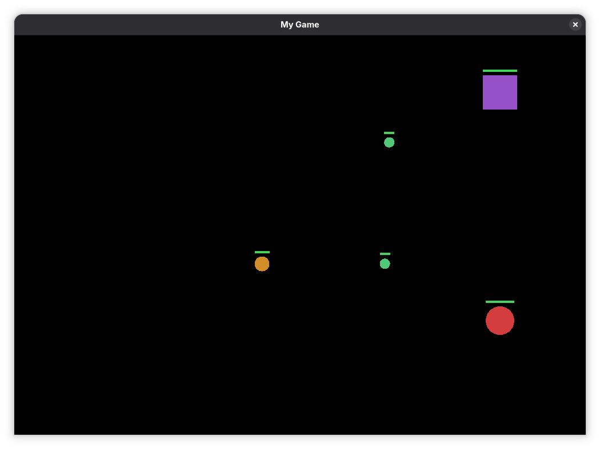
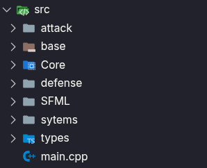

## Tower Defense


### Overview
Till now what i have built may be called a clash of clans simulator rather than a game. Yes i am working on the input output and finding ways to get the sprites ready, get defenses and troops ready. The plan was to basically make a attack and defense game. Where sides can attack and defend each other.

### How it works
1. We have a group of attacking blocks and a group of defending blocks.
2. The attacking blocks will try attacking the defense blocks closest to it, and so will the defending block will try to stop them.
3. We also have spells which will damage particular regions close to where it was deployed.
4. We have i may say a half working not so good scene builder.

### Tech Stack
I am currently using:
- C++
- SFML 2.6
- IMGUI

We build it using CMAKE.

### Future Plans
1. Add sprites
2. Make this a working game. with an effecient denfense and attack system.
3. Currently we are searching for blocks linearly, which is bad performance wise, i need to make this spatial.
4. Remove imgui and SFML and replace it by OpenGL or Vulkan. removing this may be tough cause i am not good at it (the ui stuff).
5. Make the UI more game friendly, cause currenlty it looks corporate.

### CODE
I think the code is very well written and quite understandable but still i will explain the major parts.



All these folders contain their namespaces, for example attack consists of attack namespace.

#### attack and defense
The most important file here or class here is Block and everything inherits either from:
```cpp
attack::Block
// or
defense::Block
```
Here two functions are virtual namely attack and healthLost(only for defense).
They are virtual because we have Walls and Spells. Walls dont attack and Spells dont take damage and their attacking style is much different from all others.

#### systems
This is another important namespace this has many functions which can be used by all other classes such as 
```cpp
types::Pos directionVector(types::Pos start, types::Pos end);
    float distance(types::Pos start, types::Pos end);
```

there are numerous functions. The Main part of this is it gives Blocks intelligence and combat and they can be called like:

```cpp
target = systems::findClosestAttack(this);
systems::combatDefense(target, this);
```

#### SFML
This contains all SFML abstractions. This is the main reason SFML code is not appearing everywhere.

#### Types
This is another important namespace. This not only contains the vector of all attack and defense Blocks but also contains the Levels enum and Pos (Position) struct. For simplicity purposes the vectors have been kept extern which gets messy when i would make it multiplayer and i am finding a solution for this.

#### base
This contains my worst nightmare which is imgui. The scene builder stores all the data in 2 structs.

```cpp
namespace sceneBuilder{
    struct Placement {
        std::unique_ptr<defense::Block> type;
        types::Pos positon;
    };

    struct SceneData {
        std::string userName;
        std::vector<Placement *> defenses;
    };
}
```

i know that this folder code is not well written but hopefully this would not be needed which i switch to OpenGL or Vulkan or something like pure SFML, well this does its job but the problem here is that it doen't look like it was built for a game.

#### Release
You may try out the game as i have created a pre release so far :)

Author:

[Om Thakur](https://github.com/omat100)
